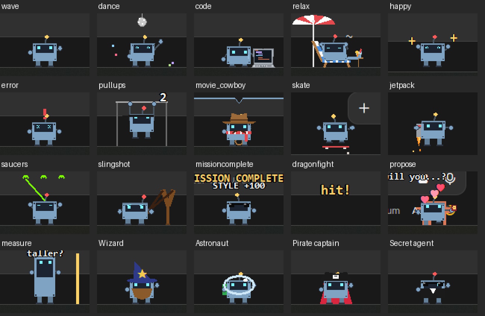
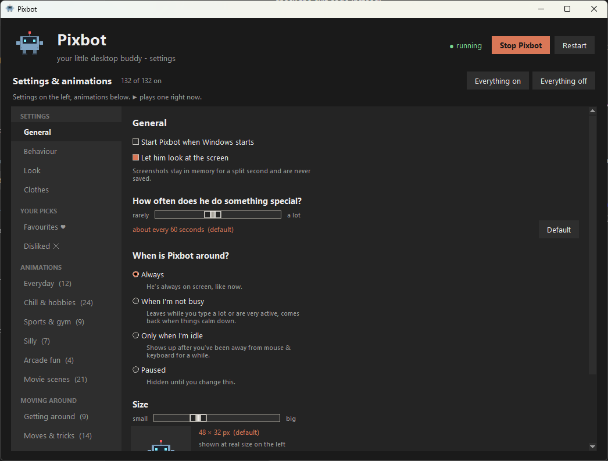

<p align="center"></p>

<h1 align="center">Pixbot</h1>
<p align="center"><b>A tiny pixel robot that lives on your Windows or Linux desktop.</b><br>
He walks along your taskbar, hops onto your windows, plays with your cursor, and has 130+ little animations.</p>

<p align="center"><a href="https://ko-fi.com/c1tribal"></a></p>



## What he does

- **Lives on your screen**: walks the taskbar, climbs window borders, hangs off ledges, swings along the top of the screen, and parachutes back down.
- **Sees what's on screen**: the edges of thumbnails, buttons and rows become platforms he can run and jump across (see *Privacy* below).
- **Reacts to you**: comes over when you're idle, types along when you type, dances or grabs popcorn while you watch a video, plays along when you're in a fullscreen game, notices new windows, copies, low battery, and more.
- **Cursor games**: reach, grab, tag, high-five, hide and seek, slide under it, and even propose to it.
- **130+ animations**: everyday, chill and hobbies, sports and gym, silly ones, arcade fun, movie-style scenes with captions, getting around (skateboard, pogo stick, flying cloud, jetpack, portal blaster, smoke bomb), moves and tricks.
- **Clothes**: 65 hats, face items and outfits, plus 15 ready-made looks.
- **Settings app**: turn every animation on or off, pick favourites and dislikes, set how calm or hyper he is, where he likes to hang out, his colour and size, when he's around, and more.



## Download and install

<p align="center"><a href="https://github.com/C1tribal/pixbot/releases/latest/download/Pixbot-Installer.exe"></a>
<a href="https://github.com/C1tribal/pixbot/releases/latest/download/Pixbot-Linux.AppImage"></a></p>

### Windows

1. Click the green button above to download **`Pixbot-Installer.exe`**.
2. Open it. If Windows says *"Windows protected your PC"*, click **More info → Run anyway**. This appears because the app isn't code-signed (signing certificates cost money), not because something is wrong. Every line of code is in this repository.
3. Click **Next** through the setup. It installs just for you (no admin password), puts a **Pixbot icon on your desktop** and adds him to the Start menu.
4. Leave **"Open Pixbot now"** ticked and click **Finish**. Pixbot appears on your taskbar and his app opens.

Next time, just double-click the **Pixbot** icon on your desktop.

**Uninstall:** Windows **Settings → Apps → Installed apps → Pixbot → Uninstall**. This also removes his settings and the start-with-Windows entry.

<details>
<summary>No installer? Use the portable version</summary>

Download [`Pixbot.exe`](https://github.com/C1tribal/pixbot/releases/latest/download/Pixbot.exe), put it in any folder and double-click it. Nothing gets installed. To remove it, delete the file and the `%APPDATA%\Pixbot` folder.
</details>

### Linux

1. Click the **Linux** button above to download **`Pixbot-Linux.AppImage`**.
2. Make it runnable: right-click it → **Properties → Permissions → Allow executing file as program**, or in a terminal:
   ```bash
   chmod +x Pixbot-Linux.AppImage
   ```
3. Double-click it. Pixbot appears at the bottom of your screen and his app opens. He also adds himself to your **app menu**, so next time just search for *Pixbot* (you can turn this off in the app).

**Remove:** untick *Show Pixbot in my app menu* and *Start Pixbot when you log in* in the app, quit Pixbot, then delete the `.AppImage` file and the `~/.config/Pixbot` folder.

Good to know on Linux:
- Pixbot runs through X11. On a **Wayland** desktop (the default on recent GNOME and KDE) he still walks around, but he can only see and climb windows of X11 apps, and he only notices your mouse when it is over one of those.
- He can't hop onto the text box you click into (that one uses a Windows-only feature).
- If the AppImage won't start, your system may be missing FUSE: on Ubuntu run `sudo apt install libfuse2t64` (22.04: `libfuse2`), or start it with `./Pixbot-Linux.AppImage --appimage-extract-and-run`.

> Downloaded a `pixbot-main.zip` full of `.py` files? That's the source code (from the green **Code** button), not the app. Use the download button above instead.

## Run from source (no .exe needed)

You need [Python 3.10+](https://www.python.org/downloads/). On Linux also install Tk: `sudo apt install python3-tk` (Debian/Ubuntu) or `sudo dnf install python3-tkinter` (Fedora).

```powershell
git clone https://github.com/c1tribal/pixbot.git
cd pixbot
python -m pip install -r requirements.txt
pythonw pixbot.pyw              # opens the Pixbot app and starts Pixbot
pythonw pixbot.pyw --pet        # starts only Pixbot, no window
```

## Privacy and safety: what Pixbot does on your PC

Everything is in this repository and you can read every line. In short:

| | |
|---|---|
| **Internet** | Pixbot never connects to the internet. The only time anything opens a web page is when *you* click a button on the Support page. |
| **Screen** | Every half second he takes a screenshot of the screen he's on, to find edges to stand on. It stays **in memory only**, is never saved to disk and never leaves your PC. You can turn this off: Settings → General → *Let him look at the screen*. |
| **Sound** | He checks whether *something* is playing (so a dance lasts until you pause the music). On Windows he reads the speaker volume level; on Linux he asks PulseAudio/PipeWire (`pactl`) whether any app has a playing stream. No sound is ever recorded. |
| **Keyboard and mouse** | He only checks *when* you last used the mouse or keyboard and roughly how fast you type (to type along with you). He never records which keys you press, apart from noticing Backspace and Caps Lock for two small reactions. |
| **Files** | Pixbot writes only his own settings, to `%APPDATA%\Pixbot` on Windows and `~/.config/Pixbot` on Linux. The Windows installer puts `Pixbot.exe` in `%LOCALAPPDATA%\Programs\Pixbot` and adds a desktop and Start-menu shortcut. The Linux AppImage adds an app-menu entry (`~/.local/share/applications/pixbot.desktop` and its icon). That's all. |
| **Startup** | Only if you tick *Start Pixbot when Windows starts / you log in* (in the installer or the app): one entry under `HKEY_CURRENT_USER\...\Run` on Windows, or one file `~/.config/autostart/pixbot.desktop` on Linux. Unticking it (or uninstalling on Windows) removes it. |
| **The downloads** | `Pixbot-Installer.exe`, `Pixbot.exe` and `Pixbot-Linux.AppImage` are built automatically by GitHub Actions from this exact source code (see [`.github/workflows/build.yml`](.github/workflows/build.yml)), and each release lists their SHA256 checksums. You can also build them yourself with [`build.ps1`](build.ps1) (Windows) or [`linux/build_appimage.sh`](linux/build_appimage.sh) (Linux). |

## What every file is

| File | What's in it |
|---|---|
| `pixbot.pyw` | The starting point. Opens the Pixbot app (which starts Pixbot), or just Pixbot with `--pet`. |
| `pixbot_pet.pyw` | Pixbot himself: movement, physics, deciding what to do next, reacting to you, screens and windows. |
| `pixbot_acts.py` | How he looks and all his animations: poses, props and effects. |
| `pixbot_movies.py` | The movie-style scenes and their caption lines. |
| `pixbot_outfits.py` | The wardrobe: every hat, face item and outfit. |
| `pixbot_app.pyw` | The settings app. |
| `pixbot_catalog.py` | The list of animations, their names and categories, and the default settings. |
| `pixbot_vision.py` | The screen reading: finds edges and pictures in an in-memory screenshot. |
| `pixbot_paths.py` | Where files live (`%APPDATA%\Pixbot` or `~/.config/Pixbot`) and how Pixbot starts itself. |
| `pixbot_os.py` | Picks the Windows or Linux version of the system helpers below. |
| `pixbot_win.py` | Windows helpers: screens, windows, mouse position, which keys are held, battery. Read-only. |
| `pixbot_linux.py` | The same helpers for Linux (X11), plus drawing his see-through windows there. Read-only. |
| `pixbot_common.py` | Sizes and colours shared by everything. |
| `pixbot_paint.py` | A tiny drawing helper used by the settings app previews and flying effects. |
| `pixbot_links.json` | The links on the Support page. |
| `build.ps1` | Builds `Pixbot.exe` with PyInstaller, and `Pixbot-Installer.exe` if Inno Setup is installed. |
| `linux/` | The Linux AppImage recipe (`build_appimage.sh`, `AppRun`, `pixbot.desktop`) and the automatic test that runs it on a virtual screen. |
| `installer/pixbot.iss` | The installer recipe (Inno Setup): where it installs, the shortcuts, the uninstaller. |
| `requirements.txt` | The Python packages Pixbot needs: `numpy`, `pillow`, plus `comtypes` and `pycaw` on Windows or `python-xlib` on Linux. |

## Build the .exe yourself

```powershell
python -m pip install -r requirements.txt pyinstaller
.\build.ps1
```

The result is `dist\Pixbot.exe`, plus `dist\Pixbot-Installer.exe` if you have [Inno Setup 6](https://jrsoftware.org/isinfo.php) installed.

On Linux (Ubuntu 22.04 or newer):

```bash
sudo apt install python3-tk fonts-dejavu-core
python3 -m pip install -r requirements.txt pyinstaller
bash linux/build_appimage.sh
```

The result is `dist/Pixbot-Linux.AppImage`. It includes the free DejaVu fonts for his speech bubbles.

## Support

Pixbot is free. If he makes your day a little better, you can [buy me a coffee on Ko-fi](https://ko-fi.com/c1tribal). Ideas for new animations are welcome in [Issues](../../issues).

## License

[MIT](LICENSE). Pixbot and all of his art, animations and text are original.
